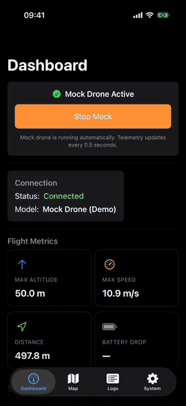
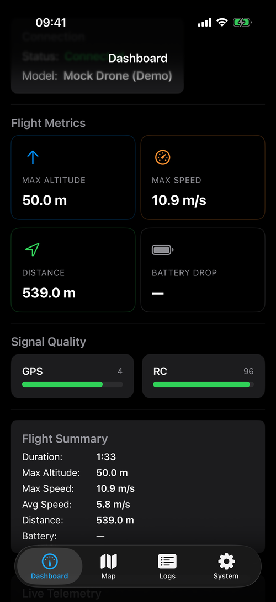
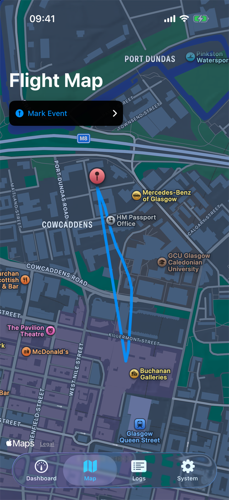
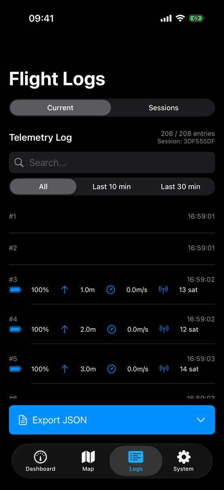
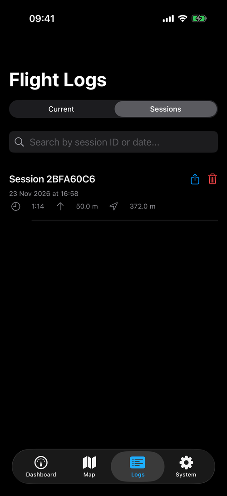
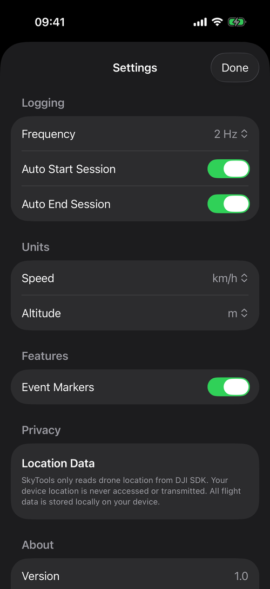
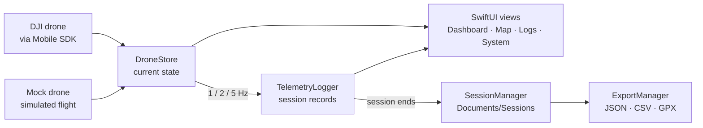

<div align="center">



# SkyTools

**An iOS companion app for DJI drones. It logs telemetry during a flight, draws the track on a map, and exports the session as JSON, CSV or GPX.**

[](LICENSE)


[Features](#features) · [How it works](#how-it-works) · [Run it](#run-it) · [Real drone](#connecting-a-real-drone) · [Limits](#limits)

</div>

SkyTools is not a flight app like DJI Fly. It does not control the drone. It sits next to it, records what the aircraft reports, and gives you the flight back afterwards.

## Features

- **Live dashboard:** battery, satellites, GPS signal, altitude, speed and heading, plus flight metrics (max altitude, max speed, distance) for the current session.
- **Flight map:** the track, start and home markers on MapKit, and event markers for interesting shots, problems and wind.
- **Sessions:** a session starts when the drone connects and is saved to disk when it ends. Browse, search and delete them in the Logs tab.
- **Export:** each saved session as JSON, CSV or GPX through the iOS share sheet.
- **Settings:** logging rate (1, 2 or 5 Hz), speed in m/s or km/h, altitude in m or ft, automatic session start and end.
- **Mock drone:** a built-in simulated flight, so every screen works without hardware.
- **Private by design:** the app reads the drone's position from the SDK and never asks for the phone's location.

<div align="center">





</div>

> **About these screenshots:** they are the real app running in the iOS Simulator with the mock drone, which flies a made-up route over central Glasgow. The DJI SDK cannot run in the simulator, so for the recording only, a stub with the same API replaced it. The app's own code is unchanged, and the mock mode never calls the SDK.

## How it works



`DroneStore` is the single source of truth: SDK delegate callbacks and the mock both write into it, and a timer samples it at the chosen rate so the log has an even cadence. The live log shows the last 1,000 records, while the session itself keeps every record in memory until it ends. A finished session is written to `Documents/Sessions/` as a JSON file plus a small summary file.

## Exports

| Format | Contents |
|---|---|
| JSON | The full session: every telemetry record, the summary and event markers |
| CSV | One row per record: timestamp, battery, satellites, altitude, speed, latitude, longitude, heading, GPS and RC signal, home point |
| GPX 1.1 | The track as `trkpt` points with elevation and time, so it opens in Google Earth or QGIS |

## Run it

You need Xcode 26 and CocoaPods.

```bash
git clone https://github.com/Bogdusik/SkyTools.git
cd SkyTools
pod install
open SkyTools.xcworkspace
```

Open the **workspace**, not the project. The Xcode project targets iOS 26.2. The code uses `NavigationStack`, so it builds for iOS 16 and later if you lower the deployment target.

To try the app without a drone, set `USE_MOCK_DRONE = true` in [SkyToolsApp.swift](SkyTools/SkyToolsApp.swift). The Dashboard then shows mock controls and starts a simulated flight.

The DJI SDK ships its simulator slice for Intel only, and recent iOS simulators on Apple silicon cannot install it. Run on a physical iPhone.

## Connecting a real drone

Set `USE_MOCK_DRONE = false`, register an app at [DJI Developer](https://developer.dji.com/), put your key in the build settings, and connect the phone to the remote controller by USB. [docs/DJI_CONNECTION.md](docs/DJI_CONNECTION.md) has the full flow, supported models and troubleshooting.

## Project structure

```
SkyTools/
├── SkyTools/
│   ├── SkyToolsApp.swift        # Entry point and DJI SDK registration
│   ├── DroneStore.swift         # Central state, SDK delegates, fixed-rate logging
│   ├── TelemetryLogger.swift    # Session records and summaries
│   ├── SessionManager.swift     # Saving and loading sessions
│   ├── ExportManager.swift      # CSV and GPX; JSON in LogsView
│   ├── EventManager.swift       # Event markers
│   ├── MockDroneService.swift   # Simulated flight
│   └── *View.swift              # Dashboard, Map, Logs, System, Settings, Onboarding
├── docs/                        # Connection guide, privacy, localisation, media
├── Podfile                      # DJI-SDK-iOS 4.16
└── LICENSE
```

## Limits

- The real-drone path is written against the DJI Mobile SDK, but everything shown here was recorded with the mock drone.
- RC signal strength is shown for the mock drone only. With a real drone the field stays empty.
- There is no automated test target. The mock drone is the way to exercise the app.
- Telemetry is sampled at up to 5 Hz. A whole session is held in memory until it ends, which is fine for a flight but not for hours of logging.

## What I learned

- **Defaults that were never applied:** the settings declared automatic sessions and event markers as on, but read them back with `UserDefaults.bool(forKey:)`, which returns `false` for a key that was never saved. A fresh install logged nothing until I ran it and saw an empty log.
- **Silent data loss:** the logger capped its buffer at 1,000 records for memory reasons, and the saved session was built from that same buffer, so any flight longer than a few minutes lost its start. I only saw it by flying a 4-minute mock session at 5 Hz and counting the saved records.
- **One source of truth:** routing both the SDK and the mock through `DroneStore` meant every screen could be built and checked without a drone.
- **Fixed-rate sampling:** the SDK calls back as often as it likes, so a timer that samples the latest state gives a log you can compare between flights.
- **Third-party binaries:** a closed-source SDK decides which platforms you can run on, including the simulator.

## License

[MIT](LICENSE)
